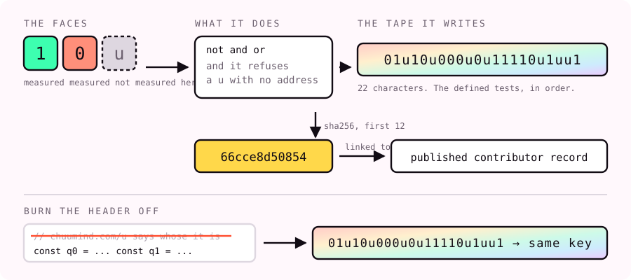

# u

Three-valued logic where every unknown says what would settle it, and checkers agree or answer u.

[**Run it in your browser**](https://chuumind.com/u/run) · [Download for offline use](https://github.com/Justichuu/u/releases/latest/download/Run-U.html) · [Changelog](CHANGELOG.md)

```js
import {known, witnesses} from 'u/why';

// Is 0.1 + 0.2 = 0.3? Exact arithmetic says yes; floating point says no.
witnesses({exact: known('1'), float: known('0')});
// {face: 'u', why: ['exact says 1, float says 0'], by: ['exact', 'float']}
```

A vote would have answered with the majority. U answers `u` and says who said what.

## Contents

- [Background](#background)
- [Install](#install)
- [Usage](#usage)
- [Reasons that travel](#reasons-that-travel)
- [Encodings: U2, U5, U6 and u-bytes](#encodings-u2-u5-u6-and-u-bytes)
- [The behavior fingerprint](#the-behavior-fingerprint)
- [The fish](#the-fish)
- [The device protocol and Rod](#the-device-protocol-and-rod)
- [API](#api)
- [Checks](#checks)
- [Contributing](#contributing)
- [Credit](#credit)
- [License](#license)

## Background

U has three faces: `1` (holds), `0` (does not hold) and `u` (not settled). Its `not`, `and` and `or`
are Kleene's strong three-valued tables. What U adds:

- **A `u` must name the one observation that would settle it.** A bare unknown is refused.
- **Reasons travel.** Every step keeps the questions that could still change the answer, and who answered.
- **Many checkers make one answer only when all of them agree.** Otherwise the answer is `u`, never a vote.
- **One more question, "is it settled?",** makes U complete: with it, U's operations build every
  two-input rule over `1`, `0` and `u` (all 19,683; without it, 197).

The name stays open: universal, unknown, unclassified, or another U name. Each implemented action has
a stated scope. The values can label holds, does not hold, and unknown; the logic combines those labels.
It does not perform measurements or authenticate a caller's claim. Two-valued logic does not itself
force a program to lie.

## Install

No installation is needed to use U in a browser: [Run U](https://chuumind.com/u/run), or download
[Run-U.html](https://github.com/Justichuu/u/releases/latest/download/Run-U.html), one file with the
logic, device protocol, source and license, which makes no network requests.

In a JavaScript project (Node 22 or later, or a browser; no dependencies):

```sh
npm install github:Justichuu/u#v1.4.0
```

In Python, copy `u.py` (and `why.py` for reasons) into your project; they use only the standard library.

## Usage

```js
import {u, not, and, or} from 'u';

const x = u('A measurement of the named condition would settle it');
or(x, not(x));   // 'u'
and(x, not(x));  // 'u'
u();             // throws: a u names the one observation that would settle it
```

```python
from u import U

U(True) & U(None, "the sensor has not reported")   # 'u'
~U(False)                                          # '1'
bool(U(None, "unread"))                            # raises: u is not true or false yet
```

The reason must be a nonempty string. The guard checks that a reason was supplied, not that it is
adequate or true; the caller retains it. The ports reject values outside the three strings. These
results describe this logic's unknown value; they do not disprove the laws of classical logic. The
compact four-line example on the website omits input validation: use the repository ports when inputs
are not already constrained to `1`, `0`, `u`.

## Reasons that travel

Justichuu, 16 October 2026: "I want to make U the best", then "Sure, start with reasons". A value is its
face, its reasons (the questions that could still change it) and `by` (who answered).

```js
import {known, unknown, and, settled, witnesses, settle} from 'u/why';

and(unknown('is the door locked?'), known('1'));
// {face: 'u', why: ['is the door locked?'], by: []}

settled(unknown('is the door locked?'));
// {face: '0', why: ['is the door locked?'], by: []}   "is it settled?" is itself known

const sure = q => (q === '2+2 = 4' ? known('1') : unknown(`no way to check "${q}"`));
settle(ask => ask('2+2 = 4'), {exact: sure, reviewer: sure});
// {face: '1', why: [], by: ['exact: 2+2 = 4', 'reviewer: 2+2 = 4']}
```

No reason that some combination of answers could need is ever dropped; a reason that turns out not to
matter may be kept. A settler that throws, or answers with a bare `u`, is heard as `u`, never as an
answer. U holds no settler of its own: the program using U brings them (an exact checker, a person, a
sensor). The checkers are assumed to fail independently: three that share a blind spot agree on it.

`why.py` is the same in Python, and `why-cli.mjs` reads formulas as JSON on stdin; `verify.mjs` checks
that the two ports give byte-identical answers.

## Encodings: U2, U5, U6 and u-bytes

**U2-bytes: three witnesses in four bits.** Justichuu, 3 October 2026: "Rules for U2, only build off u,
as i would." A U2-byte holds two bits that say `1` or `0` and one u-bit that may also say `u`. Its face
is `1` only when all three say `1`, `0` only when all three say `0`, and `u` until they agree. The
u-bit's pattern `01` is a bare u and is refused.

```js
import {agree, pack, unpack} from 'u/u2';
agree('1', '1', 'u');  // 'u': one witness has not settled
pack('1', '1', '1');   // 15, all three agree on 1
unpack(0b0110);        // ['0', '1', '0']
```

**U6.** Justichuu, 8 October 2026: "two 3 value logics mirroring 3 2 value logics to be 6 value logic
through binary logic of 2 logics = 6?" Two 3-value logics, the method's halves `chuu` and `chau`, make
six values; read across, the same six are three 2-value logics. Inside one half, not, and and or are
u's own; across halves the move is the mirror. Odd logic is weirder than even: u's not keeps `u` as it
was, and the mirror keeps no value as it was.

```js
import {u6, mirror, and6} from 'u/u6';
mirror(u6('chuu', '1'));                  // ['chau', '1']
and6(u6('chau', '1'), u6('chau', 'u'));   // ['chau', 'u']
```

**u-bytes.** Justichuu, 9 October 2026: "3 us in sequence is the bite", "So bit depth = u but
definable". A u-byte is a run of 1, 0 and u that closes on a third u: by `whole` the third u anywhere
closes it, by `every` three u's side by side do. Each is two parts, the bits between the u's and where
the u's are set, and rebuilds from them exactly. A run not yet closed is left open, never guessed shut.

```js
import {bytes, split} from 'u/u-byte';
bytes([...'10u1u0u1']);  // {bytes: ['10u1u0u'], open: '1'}
split('10u1u0u');        // {bits: '1010', at: [2, 4, 6]}
```

Every encoding builds its faces from `u.js` and holds no table of its own.

## The behavior fingerprint

In the order `1`, `0`, `u`, run `not` on each value, `and` on every pair, `or` on every pair, then check
refusal of a bare `u`. The 22-result tape is:

```text
01u10u000u0u11110u1uu1
sha256 = 66cce8d50854ee21b9964b5bdcb3aa80054f6da5e24de6258c268ea6e3942a35
```

`66cce8d50854` abbreviates that digest. The measured tape is computed by running functions; `KNOWN`
also stores the expected tape for comparison. [PROVENANCE.md](PROVENANCE.md) and
[the U page](https://chuumind.com/u) associate it with this project. This is a published association,
not an automatic identity resolver or an author signature. Independent implementations can produce the
same tape. Use the full digest when comparing records.



`node burn.mjs` removes comment lines and renames selected identifiers in the checked-in JavaScript,
preserving string literals, then runs the transformed copy and compares the tape. It uses a unique
temporary folder and removes it on normal completion or a caught error. It does not prove that every
transformation, language or future version preserves behavior.

## The fish

The browser entry carries a value along two cycloid segments, one reflected, with adjustable relative
angle, phase and pace. Swimming advances process time; NOT exchanges the branch labels at that same
time. A geometric intersection never merges the labels: with asymmetry, the branches may reach it at
different times. An unsettled `u` keeps its reason and both candidate branches. Dotted tails continue
past the numerically located intersection; the process can advance beyond the displayed section.

```js
import {carry, swim, negate, positions, geometry} from 'u/fish';
const later = swim(carry('0'), 1);
later.value;                 // '0': movement does not change truth
negate(later).value;         // '1': NOT exchanges the carried label
const reference = geometry({angle: 0, phase: 0, pace: 1});
positions(carry('u', 1, 'Read the recorded branch label.'), reference);
// In the symmetric reference, two labelled candidates share the crossing.
```

The fractal depth control repeats the whole fish on each of its two branches, forming a tree of smaller
fish. Depth 0 shows the original; depth 6 shows 127 copies, each generation at 55% of its parent's
scale. Every copy inherits the angle, phase and pace. The marker stays on the original fish. This is a
finite preview of a recursive construction; copy addresses do not add truth values. The reusable
transforms are exported from `u/fish-fractal`. Like
[Pando](https://www.fs.usda.gov/r04/fishlake/recreation/explore-forest/pando), the repeated forms
suggest connection and a shared origin. This is an analogy; the fish is not a biological model of Pando
or biodiversity.

This is a proposed geometric representation of state transport and negation. It does not make the fish
a necessary shape of binary logic or define geometric AND and OR. The three values, U2/U5 encodings and
behavior tape remain unchanged. Defaults of 3 degrees, phase 0.05 and pace 1.05 are adjustable
illustrations, not measured constants. With asymmetry, NOT is generally not a simple reflection of the
displayed point. Coordinates and intersection locations are approximate; `graphFor` exports the curve
formulas for an exact calculator. [FISH.md](FISH.md) records the W/R/A account, correction and checks.

## The device protocol and Rod

| Layer | What runs | Source |
| --- | --- | --- |
| Logic | Three string values (`1`, `0`, `u`), `not`, `and`, `or`, and a guard requiring a reason for `u` | `u.js`, `u.py`, `u.sh` |
| Device protocol | Registered adapters, scoped evidence and hash-chained receipts; a fingerprint display with timed hide, rotation and Restore | `u.mjs`, `STANDARD.md` |

[Rod](https://chuumind.com/tools/misc/rod/) is intended as a gesture and bone-conduction interface. Rod
routes its `palp-rod/1` drafts, optional Joy-Con rumble and audio through this U protocol. Its
authenticated chat connection remains ChuuWork's. A bone-conduction headset or an audio-connected rod
transducer can use the same `audio.mjs` adapter through the system audio output. Their physical
connection, bone conduction and perceived result need observation on that setup.

```js
import {createU} from 'u/protocol';
import {createAudioAdapter} from 'u/audio';
const device = await createU({name: 'Any U name'});
device.register('audio', createAudioAdapter());
// Call from a user's button, after choosing the system audio output:
await device.send('audio', {kind: 'tone', count: 1});
await device.stop(); // Resume explicitly before another send.
```

The audio adapter starts nothing on construction. It supports bounded tones and explicitly requested
speech with a local system voice. No exposed local voice stays U. A completion receipt reports browser
execution, never what a person heard. See [STANDARD.md](STANDARD.md) for the contract.

The U browser entry exercises software, not a connected rod. U is not a site-wide controller for
ChuuMind or its subdomains. Rod is one application; its working channels do not define every possible
meaning of U.

The protocol's display burn is separate from `burn.mjs`: hide, rotate, both or neither, with a stated
finite duration and an earlier Restore. Canonical provenance stays available. Neither mechanism
guarantees anonymity, erasure, recovery of deleted code, or a delay before someone identifies a copy.

## API

| Import | Exports |
| --- | --- |
| `u` (`u.js`) | `u(reason)`, `not`, `and`, `or`, `faces`, `tape()`, `KNOWN` |
| `u/why` | `known(face, by)`, `unknown(reason)`, `not`, `and`, `or`, `settled`, `witnesses(saidBy)`, `settle(formula, settlers)`, `answer(formulaJson)` |
| `u/u2` | `agree(bit, bit, ubit)`, `pack`, `unpack` |
| `u/u5` | `toU5`, `fromU5`, `pack`, `unpack` |
| `u/u6` | `halves`, `u6(half, face)`, `six`, `mirror`, `not6`, `and6`, `or6` |
| `u/u-byte` | `rules`, `bytes(stream, by)`, `split(byte)`, `join({bits, at})` |
| `u/protocol` (`u.mjs`) | `createU`, `verifyHistory`, `digest`, `canonical`, `contributors`, `STANDARD` |
| `u/audio` | `createAudioAdapter` |
| `u/fish`, `u/fish-fractal` | `carry`, `swim`, `negate`, `geometry`, `positions`, `graphFor`, ...; `copies`, `mapPoint`, `MAX_DEPTH`, `FRACTAL_SCALE` |

Python: `u.py` (`u`, `not_`, `and_`, `or_`, class `U`, `tape`, `KNOWN`) and `why.py` (the same names as
`u/why`, with `not_`, `and_`, `or_`). Shell: `u.sh` prints the tape.

## Checks

```sh
npm test                        # verify.mjs (every port agrees on the tape) and the Node tests
node burn.mjs                   # the tape survives a comment-stripping, renaming transformation
node build-browser.mjs --check  # Run-U.html contains the current sources
node checks/verify-sources.mjs  # every listed file matches SHA256SUMS.txt
```

`verify.mjs` runs `u.js`, `u.py` and `u.sh` and compares their tapes, and runs `why.js` and `why.py` on
the same formulas. Set `U_PYTHON` or `U_SHELL` to an interpreter if it is not on PATH. Exit 0 means all
listed ports agreed; 1 means a measured failure; 2 means no failure was seen but at least one runtime was
unavailable. Missing is `u`; an installed runtime that exits with an error is `0`.

With Playwright installed, `npm run test:browser` checks the fish controls and the actual offline
download. `PLAYWRIGHT_MODULE` may name an existing Playwright module file;
`BROWSERS=chromium,firefox,webkit` selects all three engines. To refresh an existing ChuuMind source
copy, run `node build-browser.mjs --site PATH_TO_SITE`, then the same command with `--check`. It writes
only this repository's browser build and the existing `nav/u/run.html`, preserving the site's
`data-proportion` marker. It does not publish.

[W] 1.4.0, 17 October 2026: 80 Node tests; `u.js`, `u.py` and Git's POSIX shell give the same tape;
`why.js` and `why.py` answer 4,068 formulas byte for byte; `u.js` and `why.js` import in Chromium; GitHub
CI passes on Linux, Windows and macOS with Node 22 and 24. [W] 24 September 2026: the browser entry and
its actual download passed in Chromium, Firefox and WebKit at phone and desktop sizes, with no HTTP
requests. A viewport is not a physical phone observation.

[U] Universal runtime support, physical adapters and authorship inferred from a tape remain
unestablished. They require the relevant runtime or device observation, or independent contribution
evidence. CI and later releases add named snapshots; they do not establish all future behavior.

## Contributing

See [CONTRIBUTING.md](CONTRIBUTING.md): run `npm test`, add a test for changed behavior, keep the module
free of runtime dependencies, and credit work with a named observation or source. Issues and pull
requests are welcome on GitHub.

Repository history: on 2 October 2026 the retired `u-core` and `u-device` repositories were consolidated
into this one; tags under `history/u-core/` and `history/u-device/` keep every original branch and
release. For example, `git show history/u-core/heads/main:u.py` reads the original core.

## Credit

Justichuu supplied the direction. Claude built the logic layer, the reasons and the repository
consolidation; Codex built the protocol and repaired the validation, checker and cleanup. The full
contributor record keeps other contributions unknown where there is no supporting observation. See
[PROVENANCE.md](PROVENANCE.md).

## License

`LicenseRef-U-Device-1.0 OR MIT`, Justichuu. [LICENSE](LICENSE) offers the published custom U Device
License 1.0 and its published MIT alternative. The custom grant requires its licence and canonical
provenance and specifies return/Restore for a display burn. The MIT option requires retaining its
copyright and permission notice in copies or substantial portions. A code edit does not automatically
remove applicable notice terms. The method is public; it is not a substitute for those terms.
